# Database schema

PostgreSQL 18 with the [`pgvector`](https://github.com/pgvector/pgvector) extension. The schema is created and changed only by Flyway migrations in [`src/main/resources/db/migration`](../src/main/resources/db/migration); Hibernate runs with `ddl-auto=validate` and never alters it.

## Conventions

- Every table has a `uuid` primary key called `id`, except `user_profiles`, which shares its key with `users`.
- Enumerated values are stored as `text`; the allowed values are listed under [Enumerated values](#enumerated-values).
- Most tables have `created_at` and a nullable `updated_at`. Child rows created together with their parent (`outfit_items`, `ai_prompt_query_outfits`, `tryon_request_items`, `stylist_searches`, `order_items`) and lookup tables have no timestamps.
- Timestamps are `timestamp without time zone`, written in UTC.
- Money is `numeric(10,2)` in EUR. Scores are `numeric(6,4)` between 0 and 1.

## Entity-relationship diagram

```mermaid
erDiagram
    users ||--|| user_profiles : "has"
    users ||--o{ refresh_tokens : "has"
    users ||--o{ user_body_photos : "uploads"
    users ||--o{ user_style_preferences : "prefers"
    style_tags ||--o{ user_style_preferences : ""
    style_tags ||--o{ product_style_tags : ""
    products ||--o{ product_style_tags : "tagged"
    products ||--o{ product_variants : "sold as"
    outfits ||--|{ outfit_items : "contains"
    products ||--o{ outfit_items : ""
    users ||--o{ feed_entries : "sees"
    outfits ||--o{ feed_entries : ""
    users ||--o{ user_outfit_interactions : "likes / saves"
    outfits ||--o{ user_outfit_interactions : ""
    users ||--o{ ai_prompt_queries : "runs"
    ai_prompt_queries ||--o{ ai_prompt_query_outfits : "returned"
    outfits ||--o{ ai_prompt_query_outfits : ""
    users ||--o{ tryon_requests : "submits"
    outfits ||--o{ tryon_requests : ""
    tryon_requests ||--|{ tryon_request_items : "renders"
    products ||--o{ tryon_request_items : ""
    users ||--o{ stylist_conversations : "chats"
    stylist_conversations ||--|{ stylist_messages : "contains"
    stylist_conversations ||--o{ stylist_searches : "runs"
    stylist_messages ||--o{ stylist_searches : "confirmed by"
    ai_prompt_queries |o--o| stylist_searches : "results"
    users ||--o{ orders : "places"
    orders ||--|{ order_items : "contains"
    product_variants ||--o{ order_items : ""
    outfits |o--o{ order_items : ""

    users {
        uuid id PK
        text email UK
        text password_hash
        text role
        timestamp created_at
        timestamp updated_at
    }
    user_profiles {
        uuid user_id PK,FK
        date birth_date
        text sex
        numeric height_cm
        numeric weight_kg
        numeric foot_length_cm
        numeric average_budget_per_outfit
        text currency
        timestamp updated_at
    }
    refresh_tokens {
        uuid id PK
        uuid user_id FK
        text token_hash UK
        timestamp expires_at
        timestamp revoked_at
        timestamp created_at
        timestamp updated_at
    }
    user_body_photos {
        uuid id PK
        uuid user_id FK
        text photo_type
        text storage_key
        timestamp created_at
        timestamp updated_at
    }
    style_tags {
        uuid id PK
        text name UK
    }
    user_style_preferences {
        uuid id PK
        uuid user_id FK
        uuid style_tag_id FK
    }
    products {
        uuid id PK
        text external_id
        text gender
        text master_category
        text sub_category
        text article_type
        text garment_role
        text base_colour
        text season
        int year
        text usage
        text product_display_name
        text fit
        text silhouette
        text pattern
        text material_guess
        text formality
        text occasion
        text primary_color
        text secondary_color
        text layering_role
        text description
        vector text_embedding "2000 dimensions"
        text image_url
        numeric base_price
        text currency
        timestamp created_at
        timestamp updated_at
    }
    product_style_tags {
        uuid id PK
        uuid product_id FK
        uuid style_tag_id FK
    }
    product_variants {
        uuid id PK
        uuid product_id FK
        text size
        int stock_quantity
        int version
    }
    outfits {
        uuid id PK
        text source
        text item_set_hash UK
        numeric compatibility_score
        numeric color_score
        numeric layering_score
        numeric structured_score
        numeric embedding_score
        timestamp created_at
        timestamp updated_at
    }
    outfit_items {
        uuid id PK
        uuid outfit_id FK
        uuid product_id FK
        text slot
    }
    feed_entries {
        uuid id PK
        uuid user_id FK
        uuid outfit_id FK
        numeric rank_score
        timestamp shown_at
        timestamp created_at
        timestamp updated_at
    }
    user_outfit_interactions {
        uuid id PK
        uuid user_id FK
        uuid outfit_id FK
        text interaction_type
        timestamp created_at
        timestamp updated_at
    }
    ai_prompt_queries {
        uuid id PK
        uuid user_id FK
        text raw_prompt
        jsonb structured_query
        boolean match_profile
        text status
        text error_message
        text model
        timestamp created_at
        timestamp updated_at
    }
    ai_prompt_query_outfits {
        uuid id PK
        uuid ai_prompt_query_id FK
        uuid outfit_id FK
        int rank
    }
    tryon_requests {
        uuid id PK
        uuid user_id FK
        uuid outfit_id FK
        text status
        text result_image_storage_key
        text error_message
        timestamp created_at
        timestamp updated_at
        timestamp completed_at
    }
    tryon_request_items {
        uuid id PK
        uuid tryon_request_id FK
        uuid product_id FK
        int sequence_order
        text status
    }
    stylist_conversations {
        uuid id PK
        uuid user_id FK
        text title
        text status
        timestamp created_at
        timestamp updated_at
        timestamp completed_at
    }
    stylist_messages {
        uuid id PK
        uuid conversation_id FK
        int sequence
        text role
        text content
        jsonb proposal
        timestamp created_at
        timestamp updated_at
    }
    stylist_searches {
        uuid id PK
        uuid conversation_id FK
        uuid proposal_message_id FK
        int position
        text title
        text prompt
        boolean match_profile
        text status
        uuid ai_prompt_query_id FK,UK
    }
    orders {
        uuid id PK
        uuid user_id FK
        text status
        numeric total_amount
        text currency
        timestamp created_at
        timestamp updated_at
    }
    order_items {
        uuid id PK
        uuid order_id FK
        uuid product_variant_id FK
        uuid outfit_id FK
        int quantity
        numeric unit_price_at_purchase
    }
```

## Tables

Columns are `NOT NULL` unless marked *nullable*.

### Identity

**`users`**: login identity.

| Column | Type | Notes |
|---|---|---|
| `id` | uuid | Primary key |
| `email` | text | Unique; stored lowercase |
| `password_hash` | text | BCrypt hash |
| `role` | text | `USER` or `ADMIN` |
| `created_at`, `updated_at` | timestamp | `updated_at` nullable |

**`user_profiles`**: one row per user, created at registration.

| Column | Type | Notes |
|---|---|---|
| `user_id` | uuid | Primary key; references `users`, deleted with the user |
| `birth_date` | date | *nullable* |
| `sex` | text | *nullable*; `MALE`, `FEMALE` or `OTHER`; can be set once |
| `height_cm` | numeric(5,2) | *nullable* |
| `weight_kg` | numeric(5,2) | *nullable* |
| `foot_length_cm` | numeric(4,1) | *nullable* |
| `average_budget_per_outfit` | numeric(10,2) | *nullable*; empty means no budget limit |
| `currency` | text | *nullable*; ISO 4217 code |
| `updated_at` | timestamp | *nullable* |

**`refresh_tokens`**: one row per issued refresh token.

| Column | Type | Notes |
|---|---|---|
| `id` | uuid | Primary key |
| `user_id` | uuid | References `users`, deleted with the user; indexed |
| `token_hash` | text | Unique; SHA-256 of the token, the token itself is never stored |
| `expires_at` | timestamp | |
| `revoked_at` | timestamp | *nullable*; set on rotation, logout or reuse detection |
| `created_at`, `updated_at` | timestamp | `updated_at` nullable |

**`user_body_photos`**: the front and back photos used for try-on.

| Column | Type | Notes |
|---|---|---|
| `id` | uuid | Primary key |
| `user_id` | uuid | References `users`, deleted with the user |
| `photo_type` | text | `FRONT` or `BACK`; unique per user |
| `storage_key` | text | Object key in Cloudflare R2 |
| `created_at`, `updated_at` | timestamp | `updated_at` changes on every re-upload |

**`style_tags`**: the fixed vocabulary of 12 styles (minimalist, streetwear, preppy, athleisure, vintage, bohemian, formal, casual, edgy, romantic, classic, sporty).

| Column | Type | Notes |
|---|---|---|
| `id` | uuid | Primary key |
| `name` | text | Unique |

**`user_style_preferences`**: `user_id` → `users` (deleted with the user), `style_tag_id` → `style_tags`; the pair is unique.

### Catalog

**`products`**: about 44,000 products from the [Fashion Product Images dataset](https://www.kaggle.com/datasets/paramaggarwal/fashion-product-images-dataset), enriched by a vision model.

| Column | Type | Notes |
|---|---|---|
| `id` | uuid | Primary key |
| `external_id` | text | Dataset id |
| `gender` | text | *nullable*; `Men`, `Women`, `Boys`, `Girls` or `Unisex` |
| `master_category`, `sub_category`, `article_type` | text | *nullable*; from the dataset |
| `garment_role` | text | *nullable*; `TOP`, `BOTTOM`, `FULL_BODY`, `FOOTWEAR`, `OUTERWEAR` or `ACCESSORY`, derived from `article_type` |
| `base_colour`, `season`, `usage`, `product_display_name`, `image_url` | text | *nullable*; from the dataset |
| `year` | integer | *nullable* |
| `fit`, `silhouette`, `pattern`, `material_guess`, `formality`, `occasion`, `primary_color`, `secondary_color`, `layering_role`, `description` | text | *nullable*; from enrichment |
| `text_embedding` | vector(2000) | *nullable*; embedding of `description` |
| `base_price` | numeric(10,2) | *nullable*; generated at enrichment |
| `currency` | text | *nullable*; always EUR |
| `created_at`, `updated_at` | timestamp | `updated_at` nullable |

**`product_style_tags`**: `product_id` → `products` (deleted with the product), `style_tag_id` → `style_tags`; the pair is unique.

**`product_variants`**: purchasable sizes, with synthetic stock for now.

| Column | Type | Notes |
|---|---|---|
| `id` | uuid | Primary key |
| `product_id` | uuid | References `products`, deleted with the product |
| `size` | text | S, M, L or XL |
| `stock_quantity` | integer | |
| `version` | integer | Optimistic-locking counter, default 0 |

### Outfits and feed

**`outfits`**: a combination of products. Outfits are shared between users and never modified; every edit creates a new outfit, or reuses an existing one with the same products.

| Column | Type | Notes |
|---|---|---|
| `id` | uuid | Primary key |
| `source` | text | `PROFILE_GENERATED`, `AI_PROMPT`, `MANUAL_SWAP`, `MANUAL_REMOVAL` or `MANUAL_ADDITION` |
| `item_set_hash` | text | Unique hash of the sorted product ids |
| `compatibility_score` | numeric(6,4) | *nullable*; the overall score |
| `color_score`, `layering_score`, `structured_score`, `embedding_score` | numeric(6,4) | Score components |
| `created_at`, `updated_at` | timestamp | `updated_at` nullable |

**`outfit_items`**

| Column | Type | Notes |
|---|---|---|
| `id` | uuid | Primary key |
| `outfit_id` | uuid | References `outfits`, deleted with the outfit; indexed |
| `product_id` | uuid | References `products` |
| `slot` | text | The product's garment role when the outfit was created |

**`feed_entries`**: one user's personalized, ranked feed.

| Column | Type | Notes |
|---|---|---|
| `id` | uuid | Primary key |
| `user_id` | uuid | References `users`, deleted with the user |
| `outfit_id` | uuid | References `outfits`; unique per user, so an outfit is never shown twice |
| `rank_score` | numeric(6,4) | Personalized score |
| `shown_at` | timestamp | *nullable*; set once the entry has been served |
| `created_at`, `updated_at` | timestamp | `updated_at` nullable |

**`user_outfit_interactions`**: likes and saves.

| Column | Type | Notes |
|---|---|---|
| `id` | uuid | Primary key |
| `user_id` | uuid | References `users`, deleted with the user |
| `outfit_id` | uuid | References `outfits` |
| `interaction_type` | text | `LIKE`, `SAVE` or `SHARE`; unique per user and outfit |
| `created_at`, `updated_at` | timestamp | `updated_at` nullable |

### AI prompt log

**`ai_prompt_queries`**: one row per prompt search, successful or not.

| Column | Type | Notes |
|---|---|---|
| `id` | uuid | Primary key |
| `user_id` | uuid | References `users`, deleted with the user |
| `raw_prompt` | text | |
| `structured_query` | jsonb | *nullable*; what the model extracted |
| `match_profile` | boolean | Whether the user's profile supplied gender and budget |
| `status` | text | `SUCCESS` or `FAILED` |
| `error_message` | text | *nullable* |
| `model` | text | The chat model that handled the prompt |
| `created_at`, `updated_at` | timestamp | `updated_at` nullable |

**`ai_prompt_query_outfits`**: the outfits a successful prompt returned. `ai_prompt_query_id` → `ai_prompt_queries` (deleted with it), `outfit_id` → `outfits`, `rank` (0 = best). The query and outfit pair is unique.

### Virtual try-on

**`tryon_requests`**

| Column | Type | Notes |
|---|---|---|
| `id` | uuid | Primary key |
| `user_id` | uuid | References `users`, deleted with the user |
| `outfit_id` | uuid | *nullable*; references `outfits` |
| `status` | text | `PENDING`, `PROCESSING`, `COMPLETE` or `FAILED` |
| `result_image_storage_key` | text | *nullable*; object key in Cloudflare R2 |
| `error_message` | text | *nullable* |
| `created_at`, `updated_at` | timestamp | `updated_at` nullable |
| `completed_at` | timestamp | *nullable*; set on `COMPLETE` and `FAILED` |

**`tryon_request_items`**: the garments rendered one after another. `tryon_request_id` → `tryon_requests` (deleted with it), `product_id` → `products`, `sequence_order`, and `status` (`PENDING`, `COMPLETE` or `FAILED`).

### Stylist chat

**`stylist_conversations`**

| Column | Type | Notes |
|---|---|---|
| `id` | uuid | Primary key |
| `user_id` | uuid | References `users`, deleted with the user |
| `title` | text | *nullable*; taken from the latest summary |
| `status` | text | `OPEN`, `EXECUTING`, `COMPLETE` or `FAILED` |
| `created_at`, `updated_at` | timestamp | `updated_at` changes on every message |
| `completed_at` | timestamp | *nullable* |

**`stylist_messages`**

| Column | Type | Notes |
|---|---|---|
| `id` | uuid | Primary key |
| `conversation_id` | uuid | References `stylist_conversations`, deleted with it |
| `sequence` | integer | 0-based position; unique per conversation |
| `role` | text | `USER` or `ASSISTANT` |
| `content` | text | |
| `proposal` | jsonb | *nullable*; on an assistant summary: `{title, summary, prompt, matchProfile}` |
| `created_at`, `updated_at` | timestamp | `updated_at` nullable |

**`stylist_searches`**: the search a confirmed summary runs.

| Column | Type | Notes |
|---|---|---|
| `id` | uuid | Primary key |
| `conversation_id` | uuid | References `stylist_conversations`, deleted with it |
| `proposal_message_id` | uuid | References the confirmed `stylist_messages` row; indexed |
| `position` | integer | Unique per conversation |
| `title`, `prompt` | text | |
| `match_profile` | boolean | |
| `status` | text | `PENDING`, `SUCCEEDED` or `FAILED` |
| `ai_prompt_query_id` | uuid | *nullable*, unique; references `ai_prompt_queries`, set to null if that row is deleted |

### Commerce (not used yet)

**`orders`**: `user_id` → `users`, `status` (`pending`, `paid`, `fulfilled` or `cancelled`), `total_amount` numeric(10,2), `currency`, timestamps.

**`order_items`**: `order_id` → `orders` (deleted with it), `product_variant_id` → `product_variants`, *nullable* `outfit_id` → `outfits`, `quantity`, `unit_price_at_purchase` numeric(10,2).

## Indexes

Besides primary keys and the unique constraints above:

| Index | Definition | Purpose |
|---|---|---|
| `idx_products_text_embedding_hnsw` | HNSW on `(text_embedding::halfvec(2000)) halfvec_cosine_ops`, `m = 16`, `ef_construction = 64` | Nearest-neighbour product search |
| `idx_feed_entries_user_rank_unseen` | `feed_entries (user_id, rank_score DESC, id DESC) WHERE shown_at IS NULL` | Feed pagination |
| `idx_outfit_items_outfit_id` | `outfit_items (outfit_id)` | Loading outfits |
| `idx_product_style_tags_style_tag_id` | `product_style_tags (style_tag_id)` | Products by style tag |
| `idx_user_outfit_interactions_outfit_id_interaction_type` | `user_outfit_interactions (outfit_id, interaction_type)` | Like counts |
| `idx_refresh_tokens_user_id` | `refresh_tokens (user_id)` | Revoking a user's tokens |
| `idx_tryon_requests_user_id_outfit_id` | `tryon_requests (user_id, outfit_id)` | Reusing renders |
| `idx_tryon_request_items_tryon_request_id` | `tryon_request_items (tryon_request_id)` | Loading a render's steps |
| `idx_stylist_conversations_user_id_updated_at_id` | `stylist_conversations (user_id, updated_at DESC, id DESC)` | Chat list |
| `idx_stylist_conversations_executing_updated_at` | `stylist_conversations (updated_at) WHERE status = 'EXECUTING'` | Recovering stuck searches |
| `idx_stylist_searches_proposal_message_id` | `stylist_searches (proposal_message_id)` | Deleting chats |

Every database connection sets `hnsw.ef_search = 100`, `hnsw.iterative_scan = relaxed_order` and `plan_cache_mode = force_custom_plan`.

## Enumerated values

| Column | Values |
|---|---|
| `users.role` | `USER`, `ADMIN` |
| `user_profiles.sex` | `MALE`, `FEMALE`, `OTHER` |
| `user_body_photos.photo_type` | `FRONT`, `BACK` |
| `products.garment_role`, `outfit_items.slot` | `TOP`, `BOTTOM`, `FULL_BODY`, `FOOTWEAR`, `OUTERWEAR`, `ACCESSORY` |
| `products.gender` | `Men`, `Women`, `Boys`, `Girls`, `Unisex` |
| `outfits.source` | `PROFILE_GENERATED`, `AI_PROMPT`, `MANUAL_SWAP`, `MANUAL_REMOVAL`, `MANUAL_ADDITION` |
| `user_outfit_interactions.interaction_type` | `LIKE`, `SAVE`, `SHARE` |
| `ai_prompt_queries.status` | `SUCCESS`, `FAILED` |
| `tryon_requests.status` | `PENDING`, `PROCESSING`, `COMPLETE`, `FAILED` |
| `tryon_request_items.status` | `PENDING`, `COMPLETE`, `FAILED` |
| `stylist_conversations.status` | `OPEN`, `EXECUTING`, `COMPLETE`, `FAILED` |
| `stylist_messages.role` | `USER`, `ASSISTANT` |
| `stylist_searches.status` | `PENDING`, `SUCCEEDED`, `FAILED` |

## Data kept in Redis

Redis holds only short-lived data that can be rebuilt: rate-limit counters, a lock that prevents two feed refills for the same user at once, and caches of outfit views (12 hours), the style-tag list and the catalog's occasion list (24 hours each). Every key expires on its own, and losing Redis data never loses anything permanent.

## Migrations

| Version | Change |
|---|---|
| V0 | Enable `pgvector` |
| V1–V5 | Initial schema: identity and profile, catalog, outfits and feed, try-on, commerce |
| V6 | Rename storage-key columns |
| V7 | User roles and refresh tokens |
| V8 | Seed the 12 style tags |
| V9 | Catalog enrichment columns |
| V10 | Embedding dimension 2000 |
| V11 | Garment roles and outfit item-set hash |
| V12 | Outfit score components, feed uniqueness and pagination index |
| V13 | Status and error message on prompt queries |
| V14 | Prompt query outfits and `match_profile` |
| V15 | Foreign-key indexes |
| V16 | HNSW vector index |
| V17 | Model name on prompt queries |
| V18 | Stylist tables |
| V19 | Stylist search index |
| V20 | Single-search stylist summaries |
